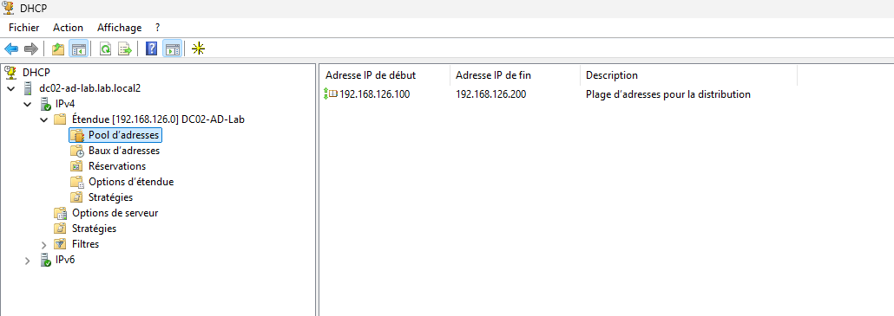
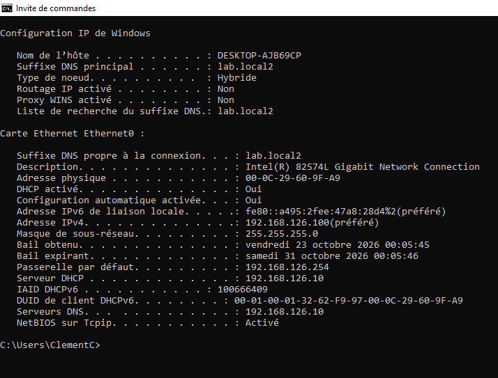
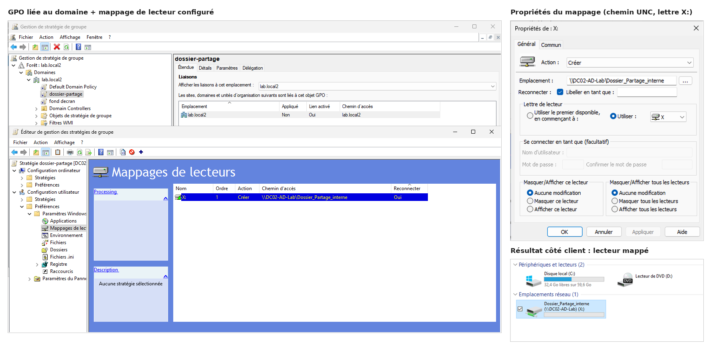

# Lab Active Directory — Windows Server

Projet personnel de lab réseau d'entreprise simplifié, monté avec VMware : un contrôleur de domaine Windows Server (AD DS, DNS, DHCP, partage de fichiers) et un poste client Windows 10 joint au domaine, avec des stratégies de groupe (GPO) appliquées. Objectif : démontrer des compétences concrètes d'administration système/réseau dans le cadre d'une recherche d'alternance (formation TSSR).

## Objectif

Mettre en place, configurer et documenter un petit réseau d'entreprise réaliste :
- Un **contrôleur de domaine** (Active Directory Domain Services) gérant l'authentification et l'annuaire.
- Un service **DNS** pour la résolution de noms du domaine.
- Un service **DHCP** pour la distribution automatique d'adresses IP.
- Un **partage de fichiers** utilisé par des stratégies de groupe.
- Des **postes clients** joints au domaine, avec des comptes utilisateurs et des GPO appliquées selon l'appartenance à un groupe.

## Architecture

```
                    ┌──────────────────────────────┐
                    │   DC02-AD-Lab (Windows Srv)   │
                    │   192.168.126.10              │
                    │   - AD DS (domaine lab.local2)│
                    │   - DNS                       │
                    │   - DHCP (192.168.126.100-200)│
                    │   - Services de fichiers       │
                    └───────────────┬────────────────┘
                                    │
                           réseau NAT (VMware, VMnet8)
                                    │
                    ┌───────────────┴───────────────┐
                    │   Client(s) Windows 10           │
                    │   IP via DHCP (ex: .100)         │
                    │   Membres du domaine lab.local2  │
                    │   GPO appliquées (fond d'écran,  │
                    │   lecteur réseau) selon le groupe│
                    └─────────────────────────────────┘
```


## Outils utilisés

- **VMware Workstation/Player** — virtualisation
- **Windows Server 2025** — contrôleur de domaine
- **Windows 10** — poste(s) client(s)
- PowerShell, invite de commandes, Gestionnaire de serveur, Gestion de stratégie de groupe

## Étapes réalisées

### 1. Mise en place du contrôleur de domaine
- Installation de Windows Server 2025 dans VMware (VM dédiée, réseau NAT).
- Ajout des rôles **AD DS**, **DNS**, **DHCP**, **Services de fichiers et de stockage** via le Gestionnaire de serveur.
- Promotion du serveur en contrôleur de domaine : création de la forêt et du domaine `lab.local2`.
- Attribution d'une adresse IP statique (`192.168.126.10`).


### 2. Configuration du DHCP
- Installation du rôle DHCP, création d'une étendue (`192.168.126.100` à `192.168.126.200`).
- Désactivation du DHCP intégré de VMware sur le réseau NAT pour éviter un conflit avec le DHCP du domaine.



### 3. Création des comptes de domaine
- Création de plusieurs comptes utilisateurs (dont Pierre Beau, Paul Bois, Clément Croix) et d'un groupe de sécurité **Responsable**, dans Active Directory Users and Computers.


### 4. Jonction de postes clients
- Installation de postes Windows 10, jonction au domaine `lab.local2`.
- Connexion réussie avec des comptes de domaine.




### 5. Stratégies de groupe (GPO)
- **Fond d'écran imposé** : GPO (Configuration utilisateur → Modèles d'administration → Bureau) pointant vers une image sur le partage de fichiers du serveur.
- **Lecteur réseau automatique** : GPO dédiée (Préférences → Mappages de lecteurs) montant un lecteur vers le dossier partagé à l'ouverture de session.
- Les deux GPO sont **ciblées sur le groupe de sécurité "Responsable"** via le ciblage au niveau de l'élément, pour ne s'appliquer qu'aux comptes concernés, même si la GPO est liée à tout le domaine.



## Problèmes rencontrés et comment ils ont été résolus

**Autorisation du serveur DHCP en échec (erreur 20070)**
Sur une itération précédente de ce lab, l'autorisation du serveur DHCP dans Active Directory échouait systématiquement après l'installation du rôle, avec un message d'erreur générique. Diagnostic mené avec `dcdiag` (contrôleur de domaine en bonne santé) puis avec l'équivalent PowerShell de l'action (`Add-DhcpServerInDC`), qui a renvoyé une erreur précise : **Access Denied**. La cause réelle : le compte utilisé pour administrer le serveur n'était pas le vrai compte intégré *Administrateur*, mais un compte local secondaire créé automatiquement par l'hyperviseur — qui n'hérite pas des droits les plus élevés (*Enterprise Admins*) accordés uniquement au vrai compte Administrateur lors de la création de la première forêt. Reconnexion avec le bon compte → problème résolu.


**Fond d'écran GPO qui ne s'affichait pas (fond noir)**
La GPO de fond d'écran s'appliquait bien (confirmé avec `gpresult /r`) et le fichier était accessible manuellement, mais l'écran restait noir. En comparant le début et la fin du champ "Nom du papier peint" dans l'éditeur de GPO (le champ, trop étroit, n'affichait que la fin du texte), le chemin contenait en fait **le nom du dossier partagé en double** (`...interne\Dossier_Partage_interne\...`), pointant vers un dossier inexistant. Correction du chemin → problème résolu.


**Lecteur réseau "orphelin" après modification d'une GPO**
En réorganisant les GPO (séparation du fond d'écran et du mappage de lecteur en deux objets distincts), le lecteur réseau restait mappé sur le client avec l'ancien chemin, même après suppression du réglage dans la GPO d'origine (confirmé avec `net use`). Cause : une Préférence de stratégie de groupe supprimée ne retire pas automatiquement ce qu'elle avait déjà appliqué sur le client, sauf si l'option **"Supprimer cet élément lorsqu'il n'est plus appliqué"** avait été cochée dès sa création. Correction ponctuelle avec `net use X: /delete` puis `gpupdate /force`.


## Compétences démontrées

- Installation et configuration de rôles Windows Server (AD DS, DNS, DHCP, Services de fichiers)
- Création et gestion d'un domaine Active Directory (utilisateurs, groupes de sécurité)
- Gestion d'adressage IP (statique, DHCP, résolution de conflits réseau)
- Création et ciblage de stratégies de groupe (GPO), y compris le ciblage au niveau de l'élément
- Diagnostic de pannes avec les outils natifs Windows (`dcdiag`, `gpresult`, PowerShell)
- Jonction de postes clients à un domaine Active Directory

## Prochaines étapes

- [ ] Créer des unités d'organisation (OU) pour mieux structurer l'annuaire
- [ ] Ajouter d'autres GPO (restrictions, sécurité)
- [ ] Documenter la structure des GPO avec des exports
- [ ] Ajouter un export des paramètres DNS/DHCP

---

*Projet en cours, documenté au fur et à mesure. Dernière mise à jour : 23/10/2026.*
